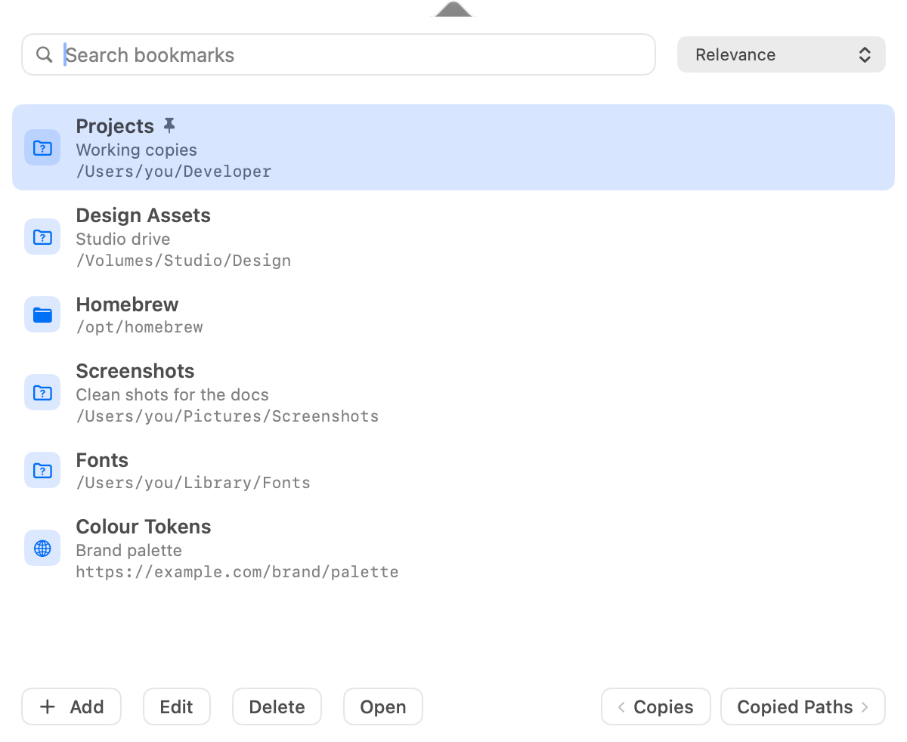

# Alt Right

A macOS menu-bar companion for Finder: your bookmarks, every path and text you copy — with
colours decoded down to NCS and RAL — and the Finder commands that only exist inside a menu.



Requires **macOS 14 Sonoma** or later. It has no Dock icon; it lives in the menu bar.

## The panel

Left-click the menu-bar icon. One 600×480 window holds three faces — **Bookmarks**,
**Copied Paths** and **Copies** — switched with `←` / `→` or the buttons in the footer.

- **Bookmarks** — the search field has focus on open. Rows show title, description and
  path; `↑`/`↓` move, one click selects, double-click or `Return` opens, `Esc` closes and
  puts focus back where it was. **Add / Edit / Delete / Open** are in the footer; adding and
  editing happen inline in the same list. Sorting is **Relevance / Name / Recently Added**;
  relevance puts pinned bookmarks first, then by how often and how recently you opened them.
- **Copied Paths** — every path you copy *anywhere*, including Finder’s own `⌥⌘C` (*Copy as
  Pathname*) and multi-line selections. Filter, then **Copy**, **Open**, **+ Bookmark**,
  **Delete** a row or **Clear All**. Only text whose every line is a path is recorded, so
  prose and code never land here.
- **Copies** — every text you copy, path or not. The footer has **Copy** and **Clear
  All**; right-click a row for Copy, **Add Bookmark…** and **Delete**. Entries stay
  byte-for-byte as they were on the clipboard.
- **Delete** (Bookmarks face) turns the list into multi-select: round checkmarks, **Delete
  N**, **Select All** / **Deselect All**, **Cancel**. No confirmation dialog.
- **Pin** — right-click a bookmark and choose *Pin* to keep it at the top of the panel and
  of relevance order.
- The panel closes on `Esc` or as soon as you switch to another app.

### Colours in Copies

A copy whose entire text is one colour gets a swatch instead of a document icon, plus
`#hex · rgb() · hsl()` under it. That covers `#FE92F5`, `FE92F5`, `#f00`, `#RRGGBBAA`,
`rgb()`/`rgba()` (numbers or percentages, commas or spaces, `/ alpha`), `hsl()`/`hsla()`,
`hsv()`/`hsb()`, a bare `254, 146, 245`, and the 148 CSS colour names. Whole-string only: a
sentence that mentions a colour stays a text row. Hover the swatch for RGB 0–1, HSV, the
nearest CSS name, WCAG luminance and contrast against white and black, and a ready-to-paste
`Color(red:green:blue:)` literal.

The paint standards work too: `NCS S 1050-Y90R`, `S 1050-Y90R`, `S1000-N`, and `RAL 3000` /
`RAL Classic 3000` (all 217 RAL Classic swatches) get a swatch and, for RAL, the name —
`RAL 3000` reads `Flame red · ≈#A72920 · rgb(167, 41, 32)`. Neither standard is defined in
RGB, so those hexes are the closest a screen gets; they are marked `≈` and the tooltip says
so. NCS hues are validated against the NCS circle (`Y→R→B→G→Y`), so `S 1050-Y90B` is not a
colour. RAL Design (`RAL 210 60 30`) is a different system and is not supported.

## Finder and menu-bar commands

| Command | Shortcut | What it does |
| --- | --- | --- |
| **Copy Path** | `⌥⌘C` | Writes the path(s) of the selection. `⌥⌘C` is Finder’s own *Copy as Pathname*; the menu item produces the same text and adds it to Copied Paths. |
| **Paste Path** | `⇧⌥⌘G` \* | Opens Finder’s *Go to Folder* sheet and pastes the clipboard path — without pressing Return, so you can check the destination. |
| **Go to Folder** | `⇧⌘G` | Presses Finder’s own *Go to Folder*. |
| **Connect to Server** | `⌘K` | Opens Finder’s *Connect to Server* dialog. |
| **Merge All Windows** | `⌃⌘M` \* | Folds every Finder window into one window as tabs. |
| **Add Bookmark** | `⇧⌥⌘B` \* | Pre-filled with Finder’s current selection, or the folder/server its front window shows when nothing is selected. Outside Finder it uses the last path Alt Right saw, then the clipboard. A multi-item Finder selection is added in one go. An unmounted network share is saved as an `smb://…` URL, so opening the bookmark connects the share. |
| **Bookmarks** | `⌥⌘B` \* | Opens the panel on Bookmarks. |
| **Copied Paths** | `⌃⌘H` \* | Opens the panel on Copied Paths. |
| **Copies** | `⌃⌘C` \* | Opens the panel on Copies. |
| **Settings** | `⌘,` | From the menu-bar menu. |

\* Registered as a system-wide hot key, so it works while any app is frontmost — not only
while a menu is open. All six are editable in Settings → Shortcuts.

**In Finder**, right-click → **Alt Right** gives you **Copy Path**, **Paste Path** and
**Add as Bookmark**. The other commands are one hot key away, or in the menu-bar menu.

**Merge All Windows** is special: Finder keeps that command only in its *Window* menu and
gives it no key equivalent of its own. Alt Right reaches it through the accessibility tree by
its stable identifier — not its (localised) title — so it works in any system language, and
beeps when there is nothing to merge.

**Right-click the menu-bar icon** for Add Bookmark, Copy Path, Paste Path, Go to Folder,
Connect to Server, Merge All Windows, Settings…, Search for Updates… and Quit.

**iCloud Drive, Google Drive, Dropbox and friends never show third-party Finder menus** —
that is an Apple limitation. Use the menu-bar icon or the hot keys there; the commands work
the same way.

## Settings


- **Setup** — whether the Finder extension is enabled and Accessibility is granted, with
  **Grant…** and **Restart Finder** buttons.
- **Opening** — where a folder opened from a bookmark or from Copied Paths lands: a **New
  window** (the default) or a **New tab** in the frontmost Finder window. A first folder
  still opens a window when no Finder window exists, and tabs need Accessibility; without it
  Alt Right falls back to a window.
- **Shortcuts** — six commands from Add Bookmark to Copies, laid out in two columns;
  click a combination and press a new one. The change is live immediately in the global hot
  keys, the menu-bar menu and the Finder submenu. **Restore Defaults** brings the standard
  combinations back.
- **Bookmarks / Copied Paths / Copies** — item counts, **Manage** (opens the panel) and
  **Clear All**.

## Privacy and limits

- Data lives at `~/Library/Application Support/Alt Right/` — `bookmarks.json`,
  `history.json`, `copy-history.json`, `shortcuts.json`. Plain JSON, never uploaded.
- The clipboard is polled every 0.7 s (no disk, no network) for Copies and Copied Paths. Text
  marked concealed, transient or auto-generated by the app that copied it — as password
  managers do — is never recorded.
- The only network request is **Search for Updates…**: it asks GitHub for the latest
  *published* release, compares versions and opens the release page. Nothing auto-installs.
- **Accessibility** is what lets the app press Finder’s shortcuts, use *New Tab*, reach
  *Merge All Windows* and open folders in tabs. **Automation → Finder** is asked once, when
  *Add Bookmark* reads the current selection.
- Listing a volume makes Finder show the Alt Right icon for it in the sidebar — Finder’s own
  behaviour for extension-enabled volumes. A *View › Customize Toolbar…* item is registered
  too.
- The UI is English only: `en.lproj` is generated by `scripts/gen_strings.py` from the
  `L("…")` keys in the sources.

## Install

### From a GitHub release (another Mac)

Download the latest `.dmg` from
[Releases](https://github.com/pavsefcik/alt-right/releases), open it and drag **Alt Right**
into **Applications**. The build is signed ad-hoc and not notarized, so remove the download
quarantine once:

```bash
xattr -dr com.apple.quarantine "/Applications/Alt Right.app"
open "/Applications/Alt Right.app"
```

Then:

1. **Finder extension** — *System Settings › General › Login Items & Extensions › Finder
   Extensions* → enable **Alt Right**. If it is not listed:
   ```bash
   pluginkit -a "/Applications/Alt Right.app/Contents/PlugIns/AltRightFinderSync.appex"
   pluginkit -e use -i com.pavel.altright.FinderSync
   killall Finder
   ```
2. **Accessibility** — open **Alt Right** from the menu bar and press **Grant…**, then turn
   the switch on by hand (macOS does not allow apps to do that).
3. **Automation** — allow *Finder* when *Add Bookmark* first reads the selection.

Permissions are per signature: a freshly downloaded build has to be granted Accessibility
again.

### From source (this Mac)

```bash
./scripts/install.sh              # Release: builds, signs with the local identity, installs to /Applications
CONFIG=Debug ./scripts/install.sh # debug build
./scripts/uninstall.sh            # removes the app and its extension registration
./scripts/package.sh              # dist/ → AltRight-<version>.dmg and .zip, ad-hoc signed
```

`install.sh` first runs `scripts/dev-signing.sh`, which creates a self-signed **Alt Right
Local Signing** identity. That keeps the code requirement stable across rebuilds, so
Accessibility survives reinstalling; an ad-hoc signature changes its hash every time.

Keep only **one** copy of the app registered. Building from Xcode while an `/Applications`
copy exists makes macOS refuse the extension: *"An extension with the same bundle ID already
exists with a different path"*. `install.sh` unregisters every other copy it finds.

## Releasing

The version is `MARKETING_VERSION` in `AltRight.xcodeproj/project.pbxproj` (all four
configurations); `Info.plist` reads it as `CFBundleShortVersionString`, and the Settings
header shows it.

```bash
# 1. bump MARKETING_VERSION, commit
./scripts/package.sh                    # 2. dist/AltRight-<version>.dmg + .zip (ad-hoc)
git tag -a v<version> -m "Alt Right <version>" && git push origin v<version>

# 3. publish with both assets; a draft or prerelease is invisible to in-app update checks
gh release create v<version> dist/AltRight-<version>.dmg dist/AltRight-<version>.zip \
  --title "Alt Right <version>" --notes-file NOTES.md
```

`dist/` is gitignored — the release assets are the only build output that gets published.
The update checker compares against `/releases/latest`, so publish (do not leave a draft) and
post the checksums in the notes.

## How it works

```
Finder ─right-click─▶ AltRightFinderSync.appex (sandboxed)
                          ├─ Copy Path: writes the pasteboard itself, then record-history
                          ├─ Add as Bookmark: altright://add-bookmark + distributed notification
                          └─ Paste Path: altright://paste-path
                                     ▼
                         Alt Right.app (unsandboxed helper)
                          ├─ Finder commands via keyboard events and the accessibility tree
                          └─ clipboard poller (0.7 s) → Copied Paths + Copies
```

A sandboxed extension cannot post keyboard events or read the app’s Application Support
files, so it hands those actions to the app over a private `altright://` URL scheme; a
distributed notification delivers already-running-app bookmarks without waiting for a launch.
The app re-registers its `kAEGetURL` handler in `applicationDidFinishLaunching`, because
SwiftUI installs its own handler at startup and would swallow the events. The extension
monitors `/`, the home folder and every mounted volume (Finder treats each volume as a
separate root), refreshing the list on mount and unmount.

## Layout

```
AltRight/                  menu-bar app (LSUIElement): settings UI, panel, Finder actuation
  Bookmarks/               bookmark, path-history and copy-history stores; editor; path parsing
  QuickPanel/              status item, the three panel faces, ranking, colour decoding
  ContentView.swift        settings window
  FinderActuator.swift     synthetic keys and Finder accessibility commands
  GlobalHotKeys.swift      Carbon hot keys for the editable shortcuts
  ShortcutConfig.swift     shortcut model and defaults
  UpdateChecker.swift      GitHub release comparison
  AppIcon.icns             generated by scripts/gen_icon.swift
AltRightFinderSync/        Finder Sync extension: submenu + hand-off
scripts/                   install, uninstall, package, dev-signing, gen_strings, gen_icon
docs/                      screenshots
```

## License

MIT — see [LICENSE](LICENSE).
