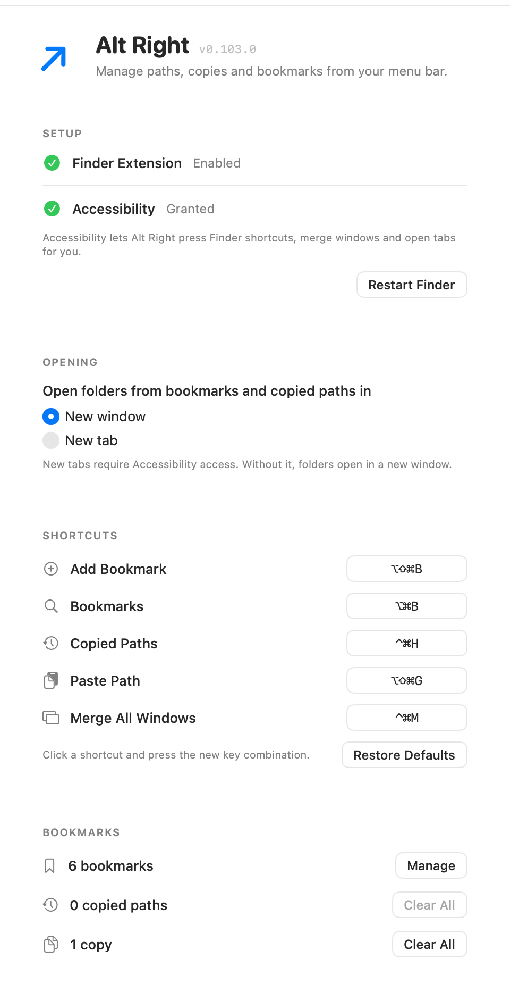

# Alt Right

A tiny macOS menu-bar app that puts the Finder shortcuts you keep googling behind one
right-click submenu.

| Command | What it does (the shortcut you'd normally press) |
| --- | --- |
| **Copy Path** | `⌥⌘C` — copies the POSIX path(s) of the selection |
| **Paste Path** | `⇧⌥⌘G` — opens Finder's *Go to Folder* sheet and pastes the clipboard path |
| **Go to Folder** | `⇧⌘G` — opens Finder's *Go to Folder* sheet |
| **Connect to Server** | `⌘K` — opens Finder's *Connect to Server* dialog |
| **Merge All Windows** | `⌃⌘M` — folds every Finder window into one window as tabs |
| **Search Bookmarks** | `⌥⌘B` — opens the all-in-one Bookmarks/History window |
| **History** | `⌃⌘H` — opens the same window on copied paths |

Right-click a file or folder → **Alt Right** gives you Copy Path, Paste Path, Search
Bookmarks, Add Bookmark and History. **Go to Folder** and **Connect to Server** live in the
menu-bar menu. *Paste Path* stops in *Go to Folder* instead of pressing Return, so you can
check the destination first.

Click the menu-bar icon for the all-in-one window: a search field you can type into
immediately, the **Relevance / Name / Recently Added** sort choice, rows with title,
description and path, and **+ Add / Edit / Delete / Open** in the footer with **History** at
the far right. The list starts with the bookmarks you actually use — pinned first, then by
how often and how recently you opened them — not with the newest one. One click selects a
row immediately, double-click opens it; type to filter, `↑`/`↓` move, `Return` opens,
`Esc` closes and puts focus back where it was. Add and Edit happen inline, and Delete turns
the rows into multi-select circles so several can go at once. Right-click the icon for Copy
Path, Paste Path, Go to Folder, Connect to Server, Merge All Windows, Settings, Search for
Updates and Quit.

**iCloud Drive, Google Drive, Dropbox and friends never show third-party Finder menus** —
that is an Apple limitation. Use the menu-bar icon there; the commands work the same way.



## Bookmarks and History

- **Bookmarks** — type to filter by title, description or path; **Open**, **Edit**,
  **Delete**, or double-click a row. Results are ordered by relevance: an exact title match
  wins, and otherwise pinning and use history decide. Switch the sort choice to **Name** or
  **Recently Added** when you want a fixed order.
- **Pin** — right-click a bookmark and choose *Pin* to keep it at the top of the quick panel
  and the relevance order. `bookmarks.json` stores `pinned`, `openCount` and `lastOpenedAt`;
  older files without those keys load with sensible defaults.
- **Edit** — correcting a stale path rewrites that bookmark in place (it does not leave the
  old one behind). **Browse…** opens a file panel when pasting a path is not what you want.
  Add and Edit happen inline in the all-in-one window — no second window to lose.
- **Delete** — switches the list to multi-select: round checkmarks appear left of each row,
  and the footer offers **Delete N**, **Select All** and **Cancel**. No confirmation dialog.
- **Add Bookmark** — pre-filled with Finder’s current selection, then the last path Alt
  Right saw, then the clipboard. From Finder, a multi-item selection is added in one go,
  with file names as titles; existing paths are skipped.
- **Path input is forgiving** — quoted paths (`'…'`, `"…"`, curly quotes), a missing
  opening or closing quote, shell-escaped spaces (`My\ Folder`), `~`, `file://` URLs, and
  `smb://`/`afp://`/`cifs://`/`nfs://` URLs are all reduced to the local path they mean.
- **History** — records *every* path you copy: Alt Right's Copy Path, Finder's own `⌥⌘C`,
  and any absolute path copied from another app. The clipboard is polled about once a
  second and only accepted when every line is a path, so prose and code are ignored. Click
  **History** in the footer to switch the same window to copied paths, filter them, and
  copy, open, bookmark them, or clear the whole list.
- **Copied colours** — a copy whose entire text is one colour gets a swatch instead of the
  document icon, plus `#hex · rgb() · hsl()` under it. `#FE92F5`, `FE92F5`, `#f00`,
  `#RRGGBBAA`, `rgb()`/`rgba()` (numbers or percentages, commas or spaces, `/ alpha`),
  `hsl()`/`hsla()`, `hsv()`/`hsb()`, a bare `254, 146, 245`, and the 148 CSS colour names
  all count. Detection is whole-string only, so a sentence that mentions a colour stays a
  text row; copying still puts the original string on the clipboard, byte for byte. Hover
  the swatch for RGB 0–1, HSV, the nearest CSS name, WCAG luminance and contrast against
  white and black, and a ready-to-paste `Color(red:green:blue:)` literal.
- **NCS and RAL** — the two paint standards also work: `NCS S 1050-Y90R`, `S 1050-Y90R`,
  `S1000-N`, and `RAL 3000`/`RAL Classic 3000` (all 217 RAL Classic swatches) get a swatch
  and, for RAL, the name — `RAL 3000` reads `Flame red · ≈#A72920 · rgb(167, 41, 32)`.
  Neither standard is defined in RGB, so those hexes are the closest a screen gets and are
  marked with `≈`; the tooltip says so, and for NCS it also names the nearest RAL swatch.
  NCS hues are validated against the NCS circle (`Y→R→B→G→Y`), so `S 1050-Y90B` is not a
  colour. RAL Design (`RAL 210 60 30`) is a different system and is not supported.
- **Open in a window or a tab** — *Settings › Opening* decides where a folder from a
  bookmark or from copied paths lands. The default is a new Finder window; choose **New
  tab** to add it to the frontmost Finder window instead. A first folder still opens a
  window when no Finder window exists, and tabs need Accessibility (otherwise Alt Right
  falls back to a window).
- The panel stays a single surface: opening a row hands focus to Finder or the browser. It
  closes on Esc or as soon as you switch to another app; double-click or Return opens a row.
- The `⌥⌘B`, `⌃⌘H` and `⇧⌥⌘G` shortcuts are registered as system-wide hot keys, so they
  work while Finder (or any other app) is frontmost — not just while a menu is open.
- In **Settings → Shortcuts**, click a combination and press a new one. The change is
  live immediately (global hot key, menu-bar menu, and the Finder submenu); **Restore
  Defaults** brings the standard combinations back.
- Data lives at `~/Library/Application Support/Alt Right/` (`bookmarks.json`,
  `history.json`) — plain JSON, never uploaded anywhere.

## Install

### From a GitHub release (another Mac)

Download the latest `.dmg` from
[Releases](https://github.com/pavsefcik/alt-right/releases), open it and drag **Alt Right**
into **Applications**. The build is signed ad-hoc and not notarized, so remove the download
quarantine once:

```bash
xattr -dr com.apple.quarantine "/Applications/Alt Right.app"
open "/Applications/Alt Right.app"
```

Then:

1. **Finder extension** — *System Settings › General › Login Items & Extensions › Finder
   Extensions* → enable **Alt Right**. If it is not listed:
   ```bash
   pluginkit -a "/Applications/Alt Right.app/Contents/PlugIns/AltRightFinderSync.appex"
   pluginkit -e use -i com.pavel.altright.FinderSync
   killall Finder
   ```
2. **Accessibility** — needed so the app can press `⇧⌘G` and `⌘K`, reach Finder's *Merge All
   Windows* and *New Tab* commands, and open folders in tabs. Open **Alt Right** from the
   menu bar and press **Grant…**, then turn the switch on by hand (macOS does not allow
   apps to do that).
3. **Automation** — macOS asks once when *Add Bookmark* reads the current Finder selection.
   Allow it.

Permissions are per signature: a freshly downloaded build has to be granted Accessibility
again.

### From source (this Mac)

```bash
./scripts/install.sh              # Release: builds, installs to /Applications, enables the extension
CONFIG=Debug ./scripts/install.sh # debug build
./scripts/uninstall.sh            # removes the app and its extension registration
./scripts/package.sh              # dist/  →  AltRight-<version>.dmg and .zip for other Macs
```

Keep only **one** copy of the app registered. Building from Xcode while an `/Applications`
copy exists makes macOS refuse the extension: *"An extension with the same bundle ID already
exists with a different path"*. `install.sh` unregisters every other copy it finds.

## How it works

```
Finder ─right-click─▶ AltRightFinderSync.appex (sandboxed)
                          ├─ Copy Path: writes the pasteboard itself
                          └─ altright://add-bookmark | search-bookmarks | open-history | paste-path
                                     ▼
                         Alt Right.app (unsandboxed helper)
```

A sandboxed extension cannot post keyboard events or read the app's Application Support
files, so it hands those actions to the app over a private URL scheme. The app re-registers
its `kAEGetURL` handler in `applicationDidFinishLaunching`, because SwiftUI installs its own
handler at startup and would swallow the events. The extension monitors `/`, the home
folder and every mounted volume (Finder treats each volume as a separate root), refreshing
the list on mount and unmount.

## Caveats

- Self-signed with a local identity — fine on your own Mac; shipping it needs a Developer ID
  certificate, hardened runtime and notarization.
- *Paste Path* pastes whatever is on the clipboard, like the real `⇧⌘G`; prose just beeps.
- Listing a volume makes Finder show the Alt Right icon for it in the sidebar — Finder's own
  behaviour for extension-enabled volumes.
- A *View › Customize Toolbar…* item ("Alt Right") is also registered.
- The UI is English only: `en.lproj` is generated by `scripts/gen_strings.py` from the
  `L("…")` keys in the sources.

## Layout

```
AltRight/                  menu-bar app (LSUIElement): settings UI, key actuation, windows
  Bookmarks/               stores, inline editor, URL payloads
  QuickPanel/              status item, all-in-one Bookmarks/History panel, ranking
  AppIcon.icns             generated by scripts/gen_icon.swift
AltRightFinderSync/        Finder Sync extension: submenu + handoff
scripts/                   install.sh, uninstall.sh, gen_strings.py, gen_icon.swift
```

## License

MIT — see [LICENSE](LICENSE).
