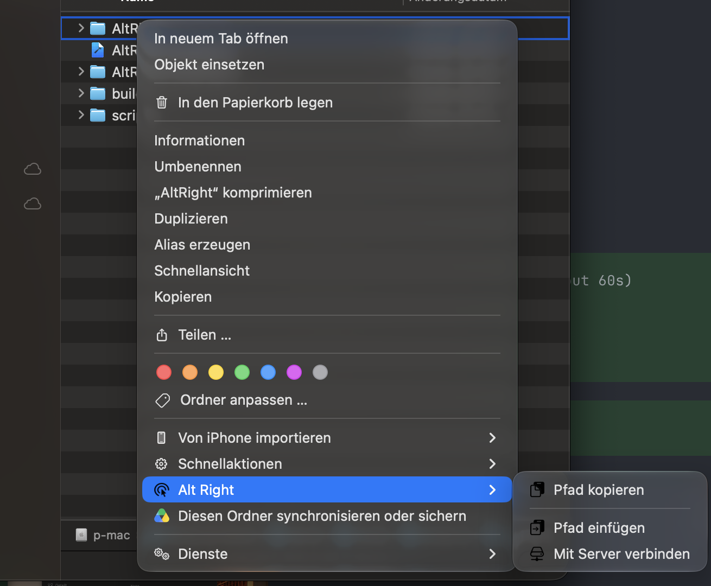

# Alt Right

A tiny macOS app that puts the Finder shortcuts you keep googling behind one right-click
submenu and the menu-bar icon:

| Command | What it does (the shortcut you'd normally press) |
| --- | --- |
| **Copy Path** | `⌥⌘C` — copies the POSIX path(s) of the selection |
| **Paste Path** | opens Finder's *Go to Folder* sheet and pastes the clipboard path |
| **Go to Folder** | `⇧⌘G` — opens Finder's *Go to Folder* sheet |
| **Connect to Server** | `⌘K` — opens Finder's *Connect to Server* dialog |
| **Search Bookmarks** | fuzzy-search saved folders, files and URLs |
| **Add Bookmark** | saves the Finder selection, or a manual path/URL |
| **History** | every path copied by Alt Right, ready to copy or open again |

Right-click a file or folder in Finder → **Alt Right** offers **Copy Path**, **Paste Path**,
**Search Bookmarks** and **Add Bookmark**. **History**, **Go to Folder** and
**Connect to Server** live in the menu-bar menu, next to their shortcuts.

**Paste Path** never navigates by itself: it fills in Finder's *Go to Folder* sheet and
waits for you to confirm with Return.

In **iCloud Drive, Google Drive and other cloud folders** macOS does not show third-party
Finder extension menus at all. Use the **Alt Right menu-bar icon** there; the commands work the same way.



## Bookmarks and History

**Search Bookmarks** opens a search window. Type to filter by title, description or path.
Select one or more entries and use **Open**, **Edit** or **Delete**; double-clicking a row
opens it. Files are revealed in Finder, folders open in Finder, and URLs open in your
default browser.

**Add Bookmark** opens an editor pre-filled from the clipboard when it contains a path or
URL. From Finder, selecting several items and choosing **Add Bookmark** adds them in one
go, using each item's filename as its title. Already-saved paths are skipped.

**History** records paths copied through Alt Right's **Copy Path**, both from the Finder
submenu and the menu bar. Entries can be copied, opened, removed, or cleared.

Bookmarks live at `~/Library/Application Support/Alt Right/bookmarks.json`; copied-path
history lives next to it in `history.json`. Both are plain JSON and stay on your Mac.

## Install

```bash
./scripts/install.sh              # builds Release, installs to /Applications, enables the extension
CONFIG=Debug ./scripts/install.sh # if you want the debug build
```

Then:

1. **Finder extension** — the script enables it, but if the submenu is missing, flip it on in
   *System Settings › General › Login Items & Extensions › Finder Extensions*.
2. **Accessibility** — needed so the app can press `⇧⌘G` and `⌘K` for you. Open **Alt Right**
   from the menu-bar icon and press **Grant…** (the switch then has to be turned on by hand,
   macOS does not allow apps to do it for you).

Uninstall with `./scripts/uninstall.sh`.

## Building in Xcode

Open `AltRight.xcodeproj`, pick the `AltRight` scheme and Run. The project has two targets:

- `AltRight` — the menu-bar app (`LSUIElement`), no dock icon, no window at launch.
- `AltRightFinderSync` — the Finder Sync extension, embedded in `Contents/PlugIns`.

Keep only **one** copy of the app registered with LaunchServices. If you both `Run` from Xcode
and keep an `/Applications` copy around, macOS refuses to load the extension with
*"An extension with the same bundle ID already exists with a different path"*.
`scripts/install.sh` handles that by unregistering every other copy it finds.

## How it works

```
Finder ──right-click──▶ AltRightFinderSync.appex  (sandboxed, local disks + mounted volumes)
                            │  Copy Path: NSPasteboard, done right here
                            │  Add Bookmark: sends the selected paths to the app
                            │
                            ├─ altright://paste-path        ──▶  Alt Right.app (unsandboxed helper)
                            ├─ altright://add-bookmark      ──▶  bookmark editor / batch add
                            ├─ altright://search-bookmarks  ──▶  bookmark search window
                            └─ altright://record-history    ──▶  copied-path history

Alt Right menu-bar icon ──▶ Alt Right.app: bookmarks, history, ⇧⌘G → ⌘V / ⇧⌘G / ⌘K (works everywhere)
```

- A sandboxed app extension can't post keyboard events and has no access to the app's
  Application Support files, so the extension delegates *Paste Path*, bookmark actions and
  history recording to the containing app over a private URL scheme.
- The app re-registers its `kAEGetURL` handler in `applicationDidFinishLaunching`, because
  SwiftUI installs its own handler while starting up and would otherwise swallow the event.
- Without Accessibility permission none of the commands can drive Finder, so the app
  explains that and offers to open the settings pane.
- *Paste Path* stops after pasting into *Go to Folder*; it does not press Return, so you
  can check or edit the destination first.
- **File Provider locations** (iCloud Drive, Google Drive, Dropbox, OneDrive, …) never show
  third-party Finder Sync menus; that is an Apple limitation. Use the menu-bar icon there.
- The extension monitors `/`, the home folder and every mounted volume, and refreshes that
  list whenever a drive is mounted or ejected. `/` alone is only the startup disk: Finder
  treats every other volume (SMB shares, USB drives, disk images) as a separate root, so
  each one has to be registered on its own — that is what made Alt Right missing on
  `/Volumes/p-server` and friends.

## Localization

The menu items and the settings UI are localized into
English, German, Spanish, French, Italian, Japanese, Korean, Dutch, Polish, Brazilian
Portuguese, Russian, Turkish, Ukrainian and Simplified Chinese — and because the app posts
raw key codes instead of looking for English menu titles, it keeps working no matter which
keyboard layout or system language is active.

`.lproj/Localizable.strings` files are generated from `scripts/gen_strings.py`
(keys are the English text, so an untranslated string simply falls back to English). To add a
language: add a dict there and run `python3 scripts/gen_strings.py`.

## Caveats

- Built ad-hoc signed (`Sign to Run Locally`) — fine on your own Mac, but shipping to other
  people needs a Developer ID certificate, hardened runtime and notarization.
- *Paste Path* pastes whatever text is on the clipboard, exactly like the real `⇧⌘G` — a
  clipboard holding prose just makes Finder beep.
- *Copy Path* copies one path per line for multi-selections, matching Finder's own behavior.
- The extension also registers a Finder toolbar item ("Alt Right"), which only appears if you
  add it with *View › Customize Toolbar…*.
- Cloud folders (iCloud Drive, Google Drive, Dropbox, OneDrive, …) have no right-click
  integration at all. macOS gives no API for it — registering the File Provider path with
  `FIFinderSyncController` does not help either. Use the menu-bar icon instead.
- Listing a volume makes Finder show the Alt Right icon for it in the sidebar. That is
  Finder's own behavior for volumes a Finder extension is active on.

## Project layout

```
AltRight/                      menu-bar app
  AltRightApp.swift            MenuBarExtra scene
  AppIcon.icns                 generated by scripts/gen_icon.swift
  AppDelegate.swift            URL-scheme handling, settings window
  ContentView.swift            settings UI + status model + menu bar
  FinderActuator.swift         the ⇧⌘G / ⌘K keystrokes + clipboard fallback
  Permissions.swift            Accessibility + settings deep links
  Support.swift                pluginkit status, Finder restart
  Bookmarks/
    Bookmark.swift             model + path normalization
    BookmarkStore.swift        bookmarks.json load/save
    FuzzyMatcher.swift         search filtering
    BookmarkOpener.swift       open/reveal/missing-path handling
    BookmarkSearchView.swift   search window
    BookmarkEditorView.swift   add/edit form
    HistoryStore.swift         history.json load/save
    HistoryView.swift          copied-path history window
    BookmarkCoordinator.swift  windows + Finder handoff routing
    BookmarkWindows.swift      AppKit window controllers
    PathPayload.swift          URL payload encoding
  *.lproj/Localizable.strings  generated strings
AltRightFinderSync/            Finder Sync extension
  FinderSync.swift             FIFinderSync subclass: submenu + Finder handoff
  *.lproj/Localizable.strings  generated strings
scripts/
  install.sh, uninstall.sh
  gen_strings.py               regenerates the .strings files
  gen_icon.swift               regenerates the app icon
```
